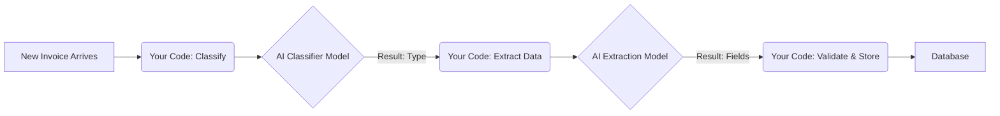
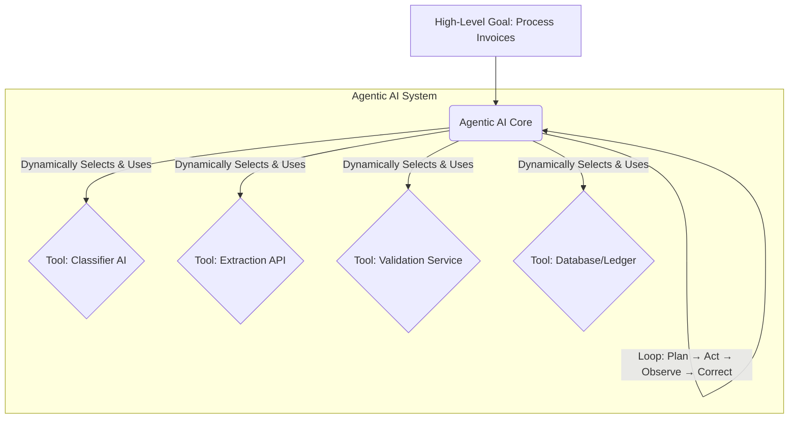

You've heard the buzz about "agentic AI." Maybe you've even seen some impressive demos. But as engineers, the real question isn't just *what* it can do, but *how* it fundamentally changes our architectural approach.

Through my own experience building complex systems, I've learned that understanding the underlying shift is crucial for using new tech well. So, let's dive into the core distinction.

My answer boils down to this: **The shift from traditional AI to agentic AI is analogous to moving from calling a stateless API endpoint to deploying a long-running, stateful service.**

## Traditional AI: Your Code is the Agent

Think about how we've typically integrated AI into our applications. Even with powerful Large Language Models (LLMs), for most problems, they've functioned as highly specialized, but ultimately **transaction-based** tools.
i.e You make an inference call, get the output.

Let's take a common scenario: building a pipeline to extract specific data from invoices.

In this setup, you, the developer, are the real agent. Your code dictates every single step:

1.  **Problem:** A new invoice needs processing.
2.  **Call Tool 1:** Your code sends the invoice image to a **Classification Model** (a traditional AI).
3.  **Get Response:** The model responds, "This is a utility bill."
4.  **Parse & Decide:** *Your code* parses that response, makes a decision ("Okay, it's a utility bill, so now I need specific fields."), and then...
5.  **Call Tool 2:** ...sends the invoice to an **Entity Extraction Model**.
6.  **Validate & Save:** *Your code* gets the extracted data, validates it, and then commits it to the database.

It's a linear, rigid sequence. If the extraction model fails or returns incomplete data, your code has to explicitly handle that error, decide on a retry, or send an alert. All the planning, error handling, and state management (remembering what happened in step 2 when you're at step 5) are firmly embedded in *your* orchestration logic.

Here's a simplified view of that flow:

*Your code is the brain. The AI models are just the hands.*

## Agentic AI: The System Becomes the Agent
With Agentic AI, you don't write that multi-step, conditional script. Instead, you give the system a high-level goal: "Process all new invoices, commit clean data to the database, and notify if human review is needed."

The Agentic AI system itself takes on the role of the orchestrator. It runs a continuous internal loop of:

Plan: Breaking down the goal into dynamic, flexible tasks.

Act: Executing those tasks by intelligently choosing and calling various external tools (which could be traditional AI models, APIs, databases, or even other scripts).

Observe: Monitoring the results of its actions and the environment.

Self-Correct: This is critical. If a tool call fails (e.g., the extraction model returns bad data), the agent reasons about the failure, updates its internal state, and adapts its plan, it might decide to enhance the image quality first, or query a different data source, then retry.

The control flow and state management are now internalized within the agentic system. The agent has its own "mind" and "memory" to pursue the goal autonomously.

Here’s how that shifts the perspective:

### A Quick Note on Building Agents
When you start building these, you'll run into two practical issues immediately:

Memory: The agent needs to remember what it did. The result of a tool call (Act) is fed back into the agent's memory or context (Observe) so it can decide what to do next.

Cost: An agent in a loop can "blow up your tokens" and costs. You must define constraints like maximum iterations or token limits to keep it from running away.

### Why This Architectural Shift Matters
This isn't just about making AI "smarter"; it's about changing how we engineer solutions:

From Explicit Orchestration to Goal-Driven Systems: We move from dictating every micro-step to defining objectives and constraints.

Adaptive Systems: This allows systems to continuously pursue goals, adapting to dynamic environments and unexpected failures.

New Engineering Challenges: This brings fascinating new problems like building robust monitoring for non-deterministic behavior, ensuring sandboxing for security, and creating clear observability into the agent's reasoning process.

But the most important part of all is evaluation.

It is now the most critical thing in Agentic AI development. We can't just evaluate the final output, we have to do Evaluation Driven Development (EDD). Every component of the agent, its planning, its tool selection, its self-correction needs to be evaluated independently.

I will talk more about evaluation in a future post, but it's the key to moving these systems from cool demos to production-ready products.

 AgenticAI AIArchitecture SoftwareEngineering LLM SystemDesign TechInsights Agentic AI ArtificialIntelligence SoftwareArchitecture Engineering TechBlog StatefulService API LLMs 
